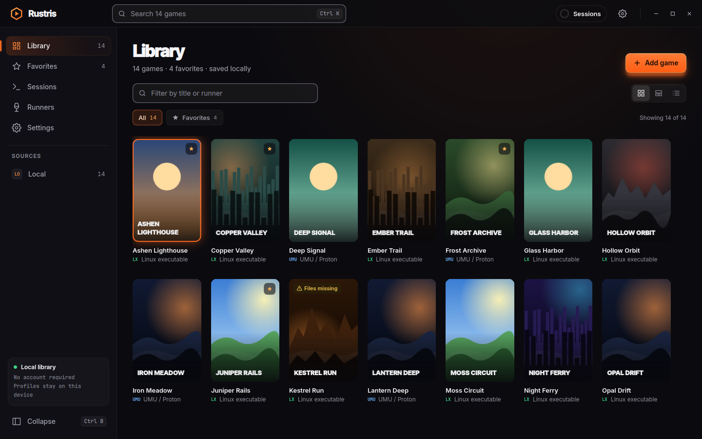
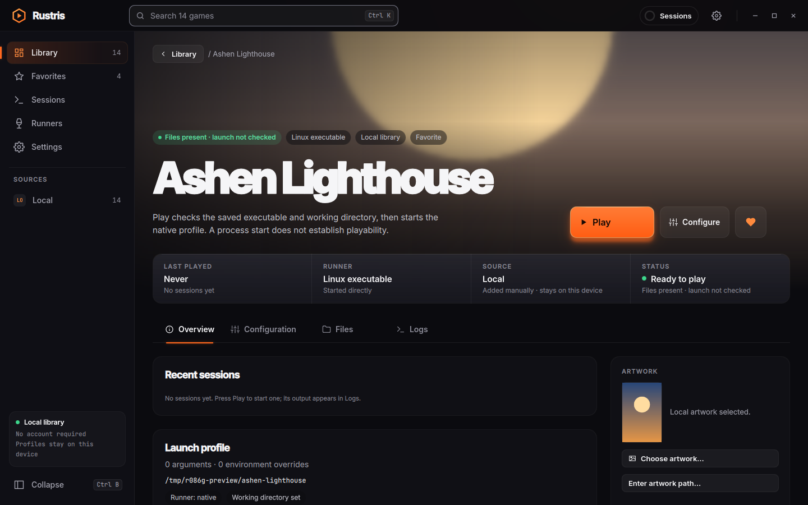
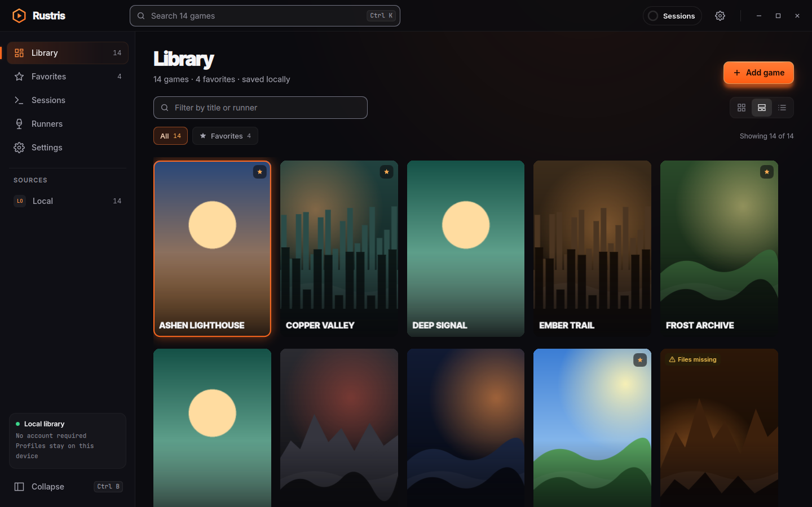
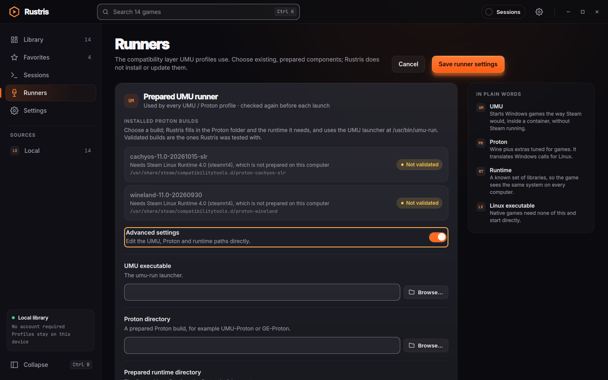
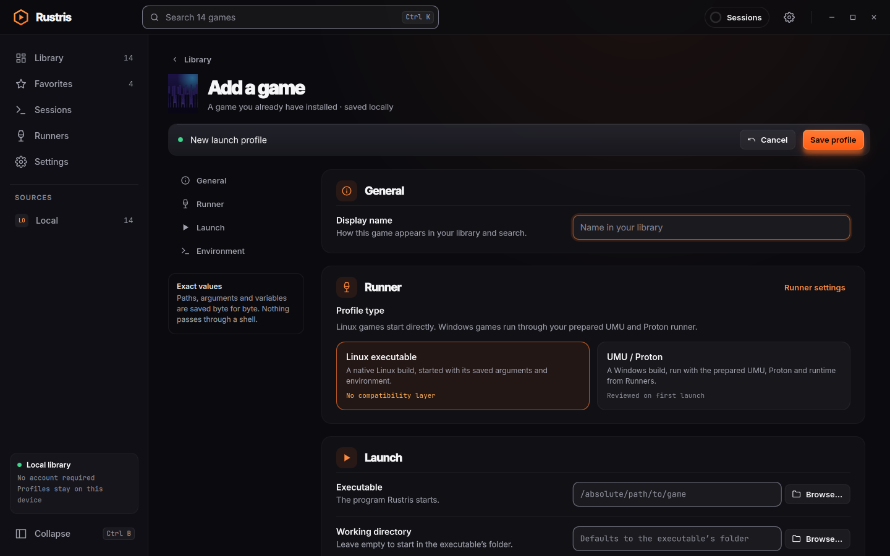
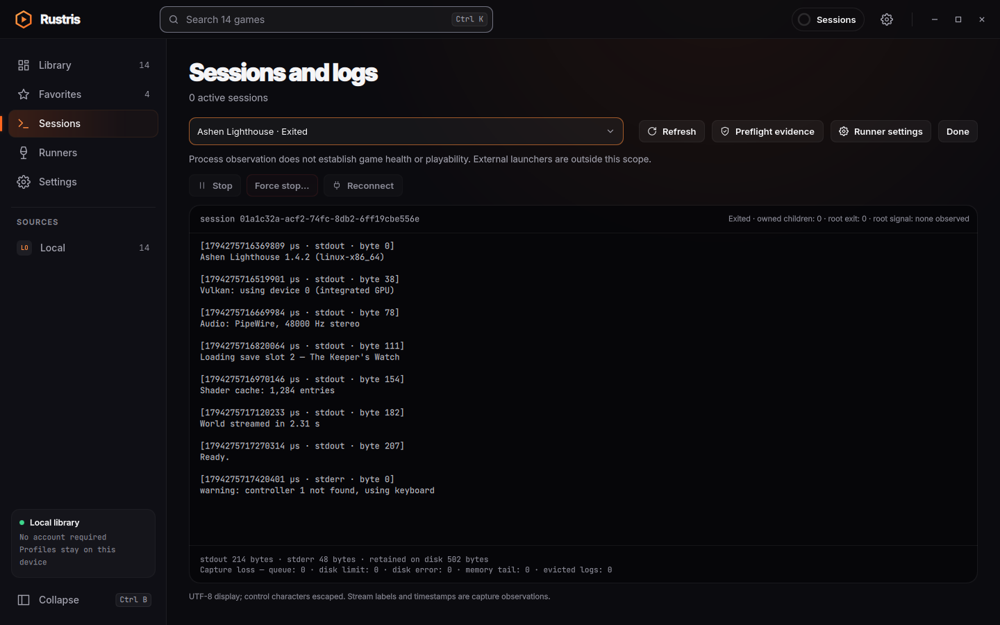
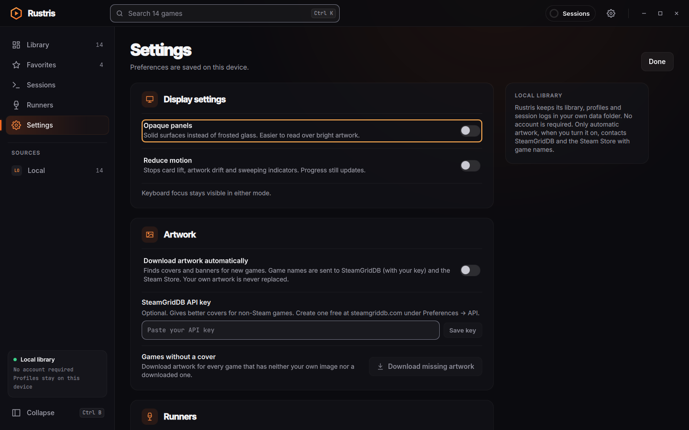

<div align="center">

# Rustris

**A fast, careful game launcher for Linux, built with Rust and Qt Quick.**

Keep your installed native and Windows games in one good-looking library, launch them through
UMU and Proton, and see exactly what happened when something goes wrong.




</div>

> [!NOTE]
> Rustris is in **early development**. There is no packaged release yet; you can build it from
> source and try it with your own games. See [Project status](#project-status) for what has and
> has not been tested.

---

## Contents

- [Highlights](#highlights)
- [Screenshots](#screenshots)
- [Features](#features)
- [Project status](#project-status)
- [Building from source](#building-from-source)
- [Installing for your user](#installing-for-your-user)
- [Using Rustris](#using-rustris)
- [Where your data lives](#where-your-data-lives)
- [Architecture](#architecture)
- [Development](#development)
- [Acknowledgements](#acknowledgements)
- [License](#license)

## Highlights

- 🎮 **One library for native and Windows games** — add the games you already have installed,
  with a grid, an artwork wall or a compact list.
- 🍷 **UMU / Proton made visible** — Rustris finds the Proton builds and Steam Linux Runtimes on
  your computer and fills in the paths for you.
- 🔍 **A launch review you can trust** — before a Windows game first starts, see the exact
  runner, prefix, arguments and environment. Approve once; Rustris asks again only if something
  changes.
- 🛡️ **Protective by default** — a Wine prefix made by a different Proton is never launched, no
  shell ever interprets your commands, and nothing is installed, updated or repaired behind
  your back.
- 📜 **Sessions and logs** — live output, preflight evidence, safe **Stop** and an explicit
  **Force stop**; games keep running and logging even if you close the launcher.
- 🖼️ **Artwork your way** — pick your own images, or let Rustris download covers and banners
  from SteamGridDB and the Steam Store (off until you turn it on).
- ⌨️ **Keyboard and screen-reader friendly** — every control is named for assistive
  technology and the whole app works from the keyboard.

## Screenshots

<table>
  <tr>
    <td width="50%"><br><sub><b>Game page</b> — play, configure and favourite, with recent sessions and artwork.</sub></td>
    <td width="50%"><br><sub><b>Artwork wall</b> — the same library, cover first.</sub></td>
  </tr>
  <tr>
    <td><br><sub><b>Runners</b> — installed Proton builds, labelled validated or not, with manual paths under Advanced settings.</sub></td>
    <td><br><sub><b>Add a game</b> — a Linux executable or a Windows game through UMU / Proton, with file pickers for every path.</sub></td>
  </tr>
  <tr>
    <td><br><sub><b>Sessions and logs</b> — live output, capture counters and preflight evidence for every session.</sub></td>
    <td><br><sub><b>Settings</b> — display preferences and automatic artwork.</sub></td>
  </tr>
</table>

## Features

### Library

- Add any installed game by name and executable path; arguments are separate tokens (spaces stay
  inside an argument) and environment variables can be set, set empty or explicitly unset.
- Search, favourites, three views and a detail page for each game with Overview,
  Configuration, Files and Logs tabs.
- Paths, arguments and environment values are stored as exact bytes, so unusual file names
  survive untouched. An **exact Unix bytes** mode lets you edit them as `\xHH` escapes.
- Removing a game only removes Rustris's record — never the game itself.

### Windows games through UMU and Proton

- The **Runners** page lists the `umu-run` launcher, every Proton build in Steam's
  `compatibilitytools.d` and `steamapps/common` folders (and `/usr/share/steam`), and the Steam
  Linux Runtimes prepared by UMU. Choosing a build fills in all three paths; **Advanced
  settings** keeps the manual fields.
- Any detected build can be used. The combinations Rustris has been tested with are marked
  **Validated**; others are labelled **Not validated**.
- A Proton build that needs a different runtime than the selected one is refused with a clear
  explanation.
- Each game uses an existing flat Wine prefix. If the prefix was created by a different Proton
  version, Rustris refuses to launch rather than silently converting it.
- Runner updates, `protonfixes` and automatic installers are disabled for launches.

### Launch review

The first time a Windows game starts, Rustris shows everything it is about to do: the UMU,
Proton and runtime versions, the effective prefix, the program, its arguments and environment,
and the evidence it collected. Once you approve, **Play** starts the game directly until any of
those details change — edit the profile or pick another runner and the review appears again.

### Sessions and logs

- A separate helper process, `rustris-session`, owns each running game, so closing the launcher
  can keep games and their logs alive; reopen Rustris to reconnect.
- **Stop** signals only processes Rustris verified it started. **Force stop** needs a prior
  Stop and a confirmation.
- Output is captured with clear limits (16 MiB per log, 256 MiB total) and visible counters if
  anything is dropped.

### Artwork

- Pick any local image for a game; Rustris keeps a reference and never modifies or deletes it.
- Turn on **Download artwork automatically** in Settings to fetch a cover and a wide banner when
  you add a game, or for your whole library at once. Rustris asks SteamGridDB first if you saved
  your own free API key, then the Steam Store. Only game names are sent, and only while the
  setting is on.
- Games without artwork get a generated landscape cover, so the library always looks complete.

## Project status

Rustris is a work in progress and has **not been released**. What exists today has been
exercised mostly in automated, private test desktops:

| Area | State |
| --- | --- |
| Library, profiles, favourites, search, artwork | Working; covered by automated desktop tests at 1×, 1.5× and 2× scaling |
| Native Linux games | Working; tested with a real native title up to window and Stop |
| Windows games via UMU / Proton | Working with the validated sets below; other builds are allowed but untested |
| Sessions, logs, Stop and reconnect | Working; covered by automated tests |
| Automatic artwork | Working with the Steam Store; SteamGridDB needs your own key |
| Gameplay, audio, controllers, networking in games | **Not verified** |
| Import from Steam, Lutris or Heroic | Not available yet — games are added by hand |
| Packages (Flatpak, AppImage, distro) | Not available yet |

**Validated runner sets:** UMU 1.4.3 with UMU-Proton-10.0-4 and Steam Linux Runtime 3.0 (sniper)
`3.0.20260805.254768`, or GE-Proton11-5 (build `1786437966`) with Steam Linux Runtime 4.0
`4.0.20261021.265997`.

> [!WARNING]
> Launching a game can change its files, its saves and its Wine prefix, as playing normally
> would. Back up any prefix you care about before trying it with Rustris.

## Building from source

### Requirements

- Linux (developed on CachyOS / Arch, x86_64)
- Rust **1.98.1** (installed automatically from `rust-toolchain.toml` by rustup)
- A C++17 compiler and `pkg-config`
- **Qt 6.12**: Core, Gui, Qml, Quick, Quick Controls 2, Quick Dialogs and Quick Effects, with
  their development files
- For Windows games: [umu-launcher](https://github.com/Open-Wine-Components/umu-launcher), a
  Proton build and the matching Steam Linux Runtime (UMU prepares the runtime)

On Arch-based systems:

```bash
sudo pacman -S --needed base-devel rustup qt6-base qt6-declarative
```

### Build

```bash
git clone https://github.com/PerkyZZ999/Rustris.git
cd Rustris
cargo build --release --workspace --locked
```

This produces two programs in `target/release/`: `rustris` (the desktop app) and
`rustris-session` (the helper that owns running games). **Keep them in the same folder.**

Run it straight away with:

```bash
./target/release/rustris
```

## Installing for your user

There are no packages yet. To install the build for your account with a menu entry:

```bash
install -Dm755 target/release/rustris ~/.local/bin/rustris
install -Dm755 target/release/rustris-session ~/.local/bin/rustris-session
cat > ~/.local/share/applications/rustris.desktop <<EOF
[Desktop Entry]
Type=Application
Name=Rustris
Comment=Linux game launcher for existing local installations
Exec=$HOME/.local/bin/rustris
Icon=applications-games
Terminal=false
Categories=Game;
EOF
```

## Using Rustris

1. **Add a game** — press **Add game** (or `Ctrl+N`), give it a name and choose its executable
   with **Browse…**.
2. **Windows games** — on the **Runners** page pick a Proton build, then in the game's
   configuration choose **UMU / Proton** and its Wine prefix folder.
3. **Play** — native games start right away; Windows games show the launch review the first
   time.
4. **Follow along** — the game's **Logs** tab and the **Sessions** page show output and status.

A longer walkthrough is in [docs/GETTING_STARTED.md](docs/GETTING_STARTED.md).

### Keyboard shortcuts

| Shortcut | Action |
| --- | --- |
| `Ctrl+N` | Add a game |
| `Ctrl+F` / `Ctrl+K` | Search |
| `Ctrl+S` | Save the profile being edited |
| `Ctrl+B` | Collapse or expand the sidebar |
| Arrow keys, `Enter` | Move through the library and open a game |
| `Escape` | Back to the library |

## Where your data lives

| What | Default location |
| --- | --- |
| Library database | `~/.local/share/rustris/library.sqlite3` |
| Downloaded artwork | `~/.local/share/rustris/artwork/` |
| Preferences, runner selection, artwork settings | `~/.config/rustris/` |
| Session logs | `~/.local/state/rustris/logs/` |

`XDG_DATA_HOME`, `XDG_CONFIG_HOME` and `XDG_STATE_HOME` are respected. All of these are private
to your user (folders `0700`, files `0600`). Before a library upgrade Rustris keeps a verified
backup of the previous version next to it. Quit Rustris before copying the data folder, and if
it reports a database error, keep the folder as it is rather than deleting the file.

## Architecture

```
QML interface ──► CXX-Qt bridge ──► bounded queues ──► Rust workers ──► SQLite
                                                    │
                                                    ├─► session worker ──► rustris-session helper ──► game
                                                    └─► artwork worker ──► SteamGridDB / Steam Store
```

| Crate | Role |
| --- | --- |
| `crates/rustris-core` | Qt-free core: library storage and migrations, profiles, UMU preparation, runner detection, sessions, artwork |
| `crates/rustris-ui` | The CXX-Qt bridge and the QML interface resources |
| `apps/desktop` | The `rustris` executable |
| `apps/session-helper` | The `rustris-session` helper that starts, watches and stops games |

The Qt thread never touches files, processes or the network; that work happens on dedicated
workers and the results are handed back as owned snapshots. Games are started with separate
argument tokens and an explicit environment — never through a shell.

## Development

```bash
cargo fmt --all --check
cargo clippy --workspace --all-targets --locked -- -D warnings
cargo test --workspace --locked
bash tests/check.sh        # all of the above plus dependency and contrast checks
```

The `tests/` folder also contains a desktop test harness that runs the real application inside a
private, offline KDE Plasma (KWin) session and drives it through the accessibility tree. It
needs a test build (`cargo build --workspace --features test-support --locked`), KWin, `bwrap`
and the AT-SPI Python bindings; for example:

```bash
python3 tests/desktop_session.py --root /tmp/rustris-suite --scale 1 --suite \
  --application target/debug/rustris
```

The default build never contains the test hooks.

## Acknowledgements

- [LutrisArtFetcher](https://github.com/PerkyZZ999/LutrisArtFetcher) — the artwork matching rules
  come from this sister project.
- [SteamGridDB](https://www.steamgriddb.com/) and the Steam Store for artwork.
- [umu-launcher](https://github.com/Open-Wine-Components/umu-launcher),
  [Proton](https://github.com/ValveSoftware/Proton) and
  [Proton-GE](https://github.com/GloriousEggroll/proton-ge-custom), which do the hard work of
  running Windows games.
- [CXX-Qt](https://github.com/KDAB/cxx-qt) for the Rust ↔ Qt bridge.

## License

A license has not been chosen yet. Until one is added, all rights are reserved by the author.
